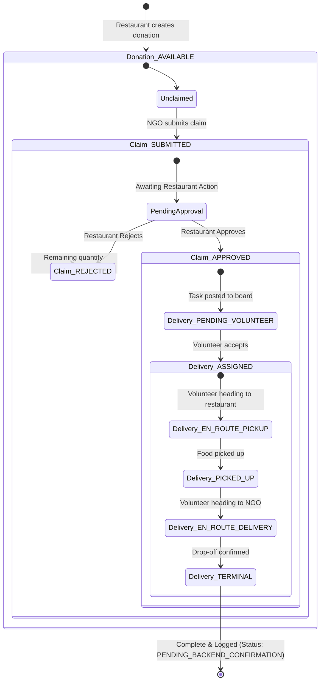

# Donation, Claim & Delivery Lifecycle — Surplus Food Rescue

**Project:** Surplus Food Rescue  
**Status:** Core Business State Machine  
**Domain Entities:** Donations, Claims, Deliveries  

---

## 1. End-to-End Workflow State Machine

The platform coordinates three distinct but tightly coupled lifecycle flows:

---

## 2. Entity State Tables

### 1. Donation Lifecycle (`DonationStatus`)

| Status | Meaning & Availability | Transition Trigger | Next Allowed States |
| :--- | :--- | :--- | :--- |
| `AVAILABLE` | Published by restaurant. Visible in NGO discovery feed. | Initial creation via `/donations`. | `PARTIALLY_CLAIMED`, `FULLY_CLAIMED`, `CANCELLED`, `EXPIRED` |
| `PARTIALLY_CLAIMED` | An approved claim has taken a portion of the food, but surplus remains. | Claim approved for `< totalQuantityKg`. | `FULLY_CLAIMED`, `COMPLETED`, `EXPIRED` |
| `FULLY_CLAIMED` | All available food quantity is claimed by approved NGOs. Hidden from feed. | Approved claim(s) equal `totalQuantityKg`. | `COMPLETED`, `CANCELLED` |
| `COMPLETED` | All deliveries for this donation have been confirmed. | Final delivery status reaches `DELIVERED`. | *Terminal State* |
| `CANCELLED` | Restaurant withdrew the donation prior to pickup. | Restaurant action (must notify claimed NGOs). | *Terminal State* |
| `EXPIRED` | Food reached perishability window before approval/pickup. | Automated expiration cron / timer. | *Terminal State* |

---

### 2. Claim Lifecycle (`ClaimStatus`)

> [!IMPORTANT]
> **Claiming Does NOT Equal Approval:** When an NGO requests a food donation, the claim is strictly in `SUBMITTED` state. The food is neither reserved nor dispatched until the donating restaurant explicitly **approves** the claim.

| Status | Meaning | Actionable Roles | Transition Trigger |
| :--- | :--- | :---: | :--- |
| `SUBMITTED` | NGO has submitted a request for X kg of food. Awaiting restaurant review. | Restaurant | NGO submits claim form. |
| `APPROVED_BY_RESTAURANT` | Restaurant verified NGO and approved handoff. Triggers delivery creation. | Volunteer | Restaurant clicks "Approve Claim". |
| `REJECTED` | Restaurant could not fulfill request (e.g. food already promised elsewhere). | NGO (Notification) | Restaurant clicks "Reject Claim" with reason. |
| `IN_TRANSIT` | Volunteer is currently transporting the claimed food. | Volunteer, NGO | Volunteer confirms pickup from restaurant. |
| `DELIVERED` | Food successfully received and confirmed by the NGO. | NGO, Volunteer | NGO / Volunteer signs off drop-off. |
| `CANCELLED` | NGO or restaurant cancelled the claim before transit started. | Restaurant, NGO | Either party cancels with reason. |

---

### 3. Delivery Lifecycle (`DeliveryStatus`)

> [!NOTE]
> **Delivery Status Alignment & Terminal State Placeholder:**
> To eliminate mismatches with backend NestJS Prisma enums, the final terminal status is recorded as `PENDING_BACKEND_CONFIRMATION`. Member 2 must confirm whether the final backend status is `DELIVERED` or `COMPLETED`. Member 1 and Member 2 will freeze either `COMPLETED` or `DELIVERED` before Phase 8 code generation. Until then, the placeholder `PENDING_BACKEND_CONFIRMATION` represents this state.

| Status | Meaning | Volunteer Action Required | Verification Method |
| :--- | :--- | :--- | :--- |
| `PENDING_VOLUNTEER` | Claim approved; task is listed on community mission board. | View task details & distance. | None (Public task pool). |
| `ASSIGNED` | Volunteer has claimed the mission. Removed from task board. | Navigate to Restaurant pickup location. | Volunteer clicks "Accept Mission". |
| `EN_ROUTE_PICKUP` | Volunteer is en route to donor restaurant. | Arrival check-in. | GPS / In-app status button. |
| `PICKED_UP` | Volunteer has verified food condition, quantity, and packaging. | Inspect food safety checklist. | Restaurant handoff confirmation (or QR scan). |
| `EN_ROUTE_DELIVERY` | Volunteer is transporting food to NGO distribution center. | Transit to drop-off address. | GPS / Map view. |
| `PENDING_BACKEND_CONFIRMATION` | Food safely handed over to NGO representative. Final terminal state. | Complete delivery sign-off. | NGO signature, photo proof, or QR confirmation. |

---

## 3. Quantity & Perishability Rules

1. **Strict Quantity Bounds:**
   - A single claim cannot request more than `donation.remainingQuantityKg`.
   - When a claim is `APPROVED_BY_RESTAURANT`:
     $$\text{remainingQuantityKg}_{\text{new}} = \text{remainingQuantityKg}_{\text{old}} - \text{claim.requestedQuantityKg}$$
   - If `remainingQuantityKg == 0`, status becomes `FULLY_CLAIMED`.
   - If a claim is `REJECTED` or `CANCELLED` before pickup, the quantity is automatically restored to the donation.

2. **Perishability & Expiry Timers:**
   - Every donation specifies `perishableBy` timestamp.
   - Frontend displays an active countdown timer (e.g. `2h 15m remaining`).
   - If current time exceeds `perishableBy`, frontend disables the "Claim" button and labels the card as `EXPIRED`.

---

## 4. Status Confirmations Requiring Member 2 (Backend) Agreement

The following state machine transitions must be validated against NestJS backend business logic:

1. **`[PENDING BACKEND CONFIRMATION]` Automatic Expiration:** Does the NestJS server run a recurring cron job (`@nestjs/schedule`) to transition overdue donations to `EXPIRED`, or does the API compute status dynamically on fetch?
2. **`[PENDING BACKEND CONFIRMATION]` Partial Claim Support:** Can a single restaurant donation be split across multiple different NGOs if quantity allows, or is a donation atomic (1 donation = 1 claim)?
3. **`[PENDING BACKEND CONFIRMATION]` Direct Restaurant Drop-off:** Can an NGO pick up food directly without a volunteer? If yes, the delivery state machine must support an optional `DIRECT_PICKUP` bypass.
4. **`PENDING_BACKEND_CONFIRMATION` Delivery Terminal Status Enum:** Member 2 must confirm whether the final backend status is `DELIVERED` or `COMPLETED`. Once confirmed, update this document and `API-CONTRACT-WORKFLOW.md`.
