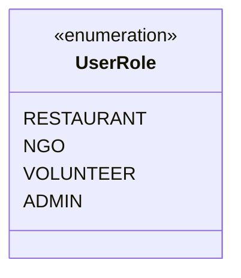

# Routing & Role-Based Access Control — Surplus Food Rescue

**Project:** Surplus Food Rescue  
**Status:** Architectural Specification  
**Routing Library:** React Router v7  

---

## 1. Supported User Roles

The platform strictly enforces role-based authorization across four distinct user roles:



1. **`RESTAURANT`**: Food donors who publish surplus listings, review claims, and confirm pickups.
2. **`NGO`**: Verified beneficiaries who discover food donations, submit claim requests, and receive deliveries.
3. **`VOLUNTEER`**: Community drivers who accept transit missions, navigate from restaurant to NGO, and log handoffs.
4. **`ADMIN`**: Platform supervisors who verify NGO and volunteer identities, audit transactions, and view aggregate metrics.

---

## 2. Complete Application Routing Table

> [!NOTE]
> **URL Routing vs. Source Feature Structure Independence:**  
> The routes below define the browser navigation hierarchy for users. They are independent of the source code module layout:
> - Route paths like `/restaurant/*`, `/ngo/*`, and `/volunteer/*` are routed via layouts in `src/app/router/`.
> - The rendered views compose underlying domain capabilities from `src/features/donations/`, `src/features/claims/`, `src/features/deliveries/`, and advanced modules (`matching`, `urgency`, `route-optimization`, `qr-verification`).
> - Domain hooks, validation schemas, and mock data remain co-located inside each domain feature, not duplicated per role.

| Path | Access Level | Layout Shell | View Description | Composed Features |
| :--- | :---: | :---: | :--- | :--- |
| `/` | Public | `PublicLayout` | Landing page, platform mission, how it works, live metrics counter. | `donations` (public counter) |
| `/login` | Public (Unauth) | `AuthLayout` | Universal login portal with email/password. | `auth` |
| `/register` | Public (Unauth) | `AuthLayout` | Multi-step registration with role selection. | `auth` |
| `/unauthorized` | Public | `PublicLayout` | 403 Forbidden feedback with return navigation. | `common` |
| **Restaurant Routes** | | | | |
| `/restaurant/dashboard` | `RESTAURANT` | `DashboardLayout` | Active donations overview, pending claim alerts, food safety counter. | `restaurant`, `donations`, `claims` |
| `/restaurant/donations/new`| `RESTAURANT` | `DashboardLayout` | Multi-step surplus donation creation wizard. | `donations` |
| `/restaurant/donations` | `RESTAURANT` | `DashboardLayout` | Complete donation history, active listings, cancellation controls. | `donations` |
| `/restaurant/claims/review`| `RESTAURANT` | `DashboardLayout` | Dedicated interface to approve or reject pending NGO claims. | `claims`, `donations` |
| **NGO Routes** | | | | |
| `/ngo/dashboard` | `NGO` | `DashboardLayout` | Incoming food deliveries, claim statuses, meals distributed. | `ngo`, `claims`, `deliveries` |
| `/ngo/discover` | `NGO` | `DashboardLayout` | Interactive food discovery feed with category, distance & urgency filters. | `donations`, `claims`, `urgency`, `matching` |
| `/ngo/claims` | `NGO` | `DashboardLayout` | History of requested, approved, and rejected food claims. | `claims`, `donations` |
| **Volunteer Routes** | | | | |
| `/volunteer/dashboard` | `VOLUNTEER` | `DashboardLayout` | Available missions nearby, active assigned transit task. | `volunteer`, `deliveries` |
| `/volunteer/tasks` | `VOLUNTEER` | `DashboardLayout` | Mission board with pickup/drop-off distance and timing windows. | `deliveries`, `route-optimization` |
| `/volunteer/delivery/:id` | `VOLUNTEER` | `DeliveryLayout` | Dedicated mobile delivery cockpit: GPS directions, contact info, proof of delivery. | `deliveries`, `qr-verification` |
| **Admin Routes** | | | | |
| `/admin/dashboard` | `ADMIN` | `DashboardLayout` | High-level metrics: total kg rescued, meals served, carbon offset. | `admin`, `donations`, `deliveries` |
| `/admin/verifications` | `ADMIN` | `DashboardLayout` | Reviewing NGO registrations, 501(c)(3) documents, and volunteer IDs. | `admin`, `auth` |
| `/admin/audit-log` | `ADMIN` | `DashboardLayout` | System-wide immutable transaction log for food safety audits. | `admin` |

---

## 3. Route Guard & Protected Route Architecture

Access control is implemented declaratively via nested layout guards:

### 1. The `<ProtectedRoute>` Component
```tsx
// src/app/router/ProtectedRoute.tsx
import React from 'react';
import { Navigate, Outlet, useLocation } from 'react-router-dom';
import { useAuth } from '@/app/providers/AuthProvider';
import { UserRole } from '@/types/domain';
import { LoadingSpinner } from '@/components/ui/LoadingSpinner';

interface ProtectedRouteProps {
  allowedRoles?: UserRole[];
}

export const ProtectedRoute: React.FC<ProtectedRouteProps> = ({ allowedRoles }) => {
  const { user, isAuthenticated, isLoading } = useAuth();
  const location = useLocation();

  if (isLoading) {
    return (
      <div className="flex items-center justify-center min-h-screen">
        <LoadingSpinner size="lg" />
      </div>
    );
  }

  // Not logged in -> Redirect to login with return path
  if (!isAuthenticated || !user) {
    return <Navigate to="/login" state={{ from: location }} replace />;
  }

  // Logged in, but lacks required role -> Redirect to 403 Forbidden page
  if (allowedRoles && !allowedRoles.includes(user.role)) {
    return <Navigate to="/unauthorized" replace />;
  }

  // Authorized -> Render child route
  return <Outlet />;
};
```

### 2. Router Tree Composition
```tsx
// src/app/router/index.tsx
import { createBrowserRouter } from 'react-router-dom';
import { RootLayout } from '@/app/layouts/RootLayout';
import { DashboardLayout } from '@/app/layouts/DashboardLayout';
import { ProtectedRoute } from '@/app/router/ProtectedRoute';
import { UserRole } from '@/types/domain';

export const router = createBrowserRouter([
  {
    path: '/',
    element: <RootLayout />,
    children: [
      { index: true, element: <LandingPage /> },
      { path: 'login', element: <LoginPage /> },
      { path: 'register', element: <RegisterPage /> },
      { path: 'unauthorized', element: <UnauthorizedPage /> },
      
      // Protected Restaurant Routes
      {
        element: <ProtectedRoute allowedRoles={[UserRole.RESTAURANT]} />,
        children: [
          {
            path: 'restaurant',
            element: <DashboardLayout />,
            children: [
              { path: 'dashboard', element: <RestaurantDashboardPage /> },
              { path: 'donations/new', element: <CreateDonationPage /> },
              { path: 'claims/review', element: <ReviewClaimsPage /> },
            ],
          },
        ],
      },
      
      // Protected NGO Routes
      {
        element: <ProtectedRoute allowedRoles={[UserRole.NGO]} />,
        children: [
          {
            path: 'ngo',
            element: <DashboardLayout />,
            children: [
              { path: 'dashboard', element: <NgoDashboardPage /> },
              { path: 'discover', element: <FoodDiscoveryPage /> },
              { path: 'claims', element: <NgoClaimsPage /> },
            ],
          },
        ],
      },
      
      // Protected Volunteer Routes
      {
        element: <ProtectedRoute allowedRoles={[UserRole.VOLUNTEER]} />,
        children: [
          {
            path: 'volunteer',
            element: <DashboardLayout />,
            children: [
              { path: 'dashboard', element: <VolunteerDashboardPage /> },
              { path: 'tasks', element: <VolunteerTasksPage /> },
              { path: 'delivery/:id', element: <DeliveryCockpitPage /> },
            ],
          },
        ],
      },
      
      // Protected Admin Routes
      {
        element: <ProtectedRoute allowedRoles={[UserRole.ADMIN]} />,
        children: [
          {
            path: 'admin',
            element: <DashboardLayout />,
            children: [
              { path: 'dashboard', element: <AdminDashboardPage /> },
              { path: 'verifications', element: <AdminVerificationsPage /> },
            ],
          },
        ],
      },
    ],
  },
]);
```

---

## 4. Redirect Behavior & Session Continuity

1. **Post-Login Redirection:**
   - When a user logs in, the authentication context checks `location.state?.from`.
   - If present, redirects back to the deep link they attempted to open.
   - Otherwise, redirects to their role's default home (`/restaurant/dashboard`, `/ngo/dashboard`, `/volunteer/dashboard`, or `/admin/dashboard`).
2. **Unauthorized Navigation (403):**
   - If an NGO attempts to access a restaurant URL, they are smoothly redirected to `/unauthorized`.
   - The `/unauthorized` view displays a clear notice with a button: "Return to your Dashboard".
