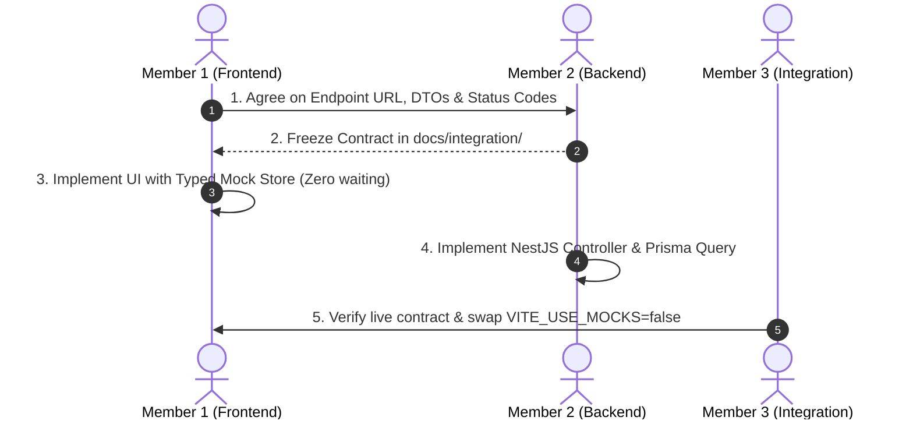

# API Contract & Mocking Workflow — Surplus Food Rescue

**Project:** Surplus Food Rescue  
**Status:** Working Integration Contract  
**Frontend Client:** Axios / Fetch + TanStack Query v5  
**Backend Framework:** NestJS + Prisma ORM  

---

## 1. Contract-First Methodology

To eliminate frontend delays while the NestJS backend is under construction, the team uses a **Contract-First Workflow**:



---

## 2. Global API Client & Network Architecture

### 1. Base Configuration & Interceptors
The frontend uses a centralized API client instance located at `src/services/apiClient.ts`:
- **Base URL:** Loaded via `import.meta.env.VITE_API_BASE_URL` (default: `http://localhost:4000/api/v1`).
- **Request Interceptor:** Automatically injects the JWT authorization token if present:
  ```ts
  // Authorization: Bearer <token>
  ```
- **Response Interceptor:** Normalizes NestJS error payloads into a standard `ApiError` interface:
  ```ts
  export interface ApiError {
    statusCode: number;
    message: string | string[];
    error: string;
    timestamp: string;
  }
  ```

---

## 3. Confirmed vs. Pending API Contracts

Below is the exhaustive contract registry. Endpoints are categorized as either **CONFIRMED** (both frontend and backend agreed) or **PENDING CONTRACT CONFIRMATION** (draft structure awaiting Member 2 review).

### Authentication & Profiles (`/auth`, `/users`)
| Method | Endpoint | Status | Description | Request Body | Response Payload |
| :--- | :--- | :---: | :--- | :--- | :--- |
| `POST` | `/auth/register` | **CONFIRMED** | Register new user & organization | `{ email, password, name, role, organizationName, phone }` | `{ user: { id, email, role }, token: string }` |
| `POST` | `/auth/login` | **CONFIRMED** | Authenticate user credentials | `{ email, password }` | `{ user: { id, email, role, name }, token: string }` |
| `GET` | `/users/me` | **CONFIRMED** | Retrieve current user profile | *None* | `UserProfile` |

### Food Donations (`/donations`)
| Method | Endpoint | Status | Description | Request Body | Response Payload |
| :--- | :--- | :---: | :--- | :--- | :--- |
| `GET` | `/donations` | **CONFIRMED** | Public / NGO discovery feed (filters: status, radius, category) | *Query params: `?status=AVAILABLE&radius=10`* | `{ data: DonationRecord[], total: number }` |
| `POST` | `/donations` | **CONFIRMED** | Restaurant creates food donation | `CreateDonationDTO` (foodType, quantityKg, expiryHours, safetyNotes, location) | `DonationRecord` |
| `GET` | `/donations/:id`| **CONFIRMED** | Single donation detail | *None* | `DonationDetailRecord` |
| `PATCH`| `/donations/:id/cancel` | `[PENDING CONTRACT CONFIRMATION]` | Restaurant cancels unclaimed donation | `{ reason: string }` | `DonationRecord` |

### Claims & Approvals (`/claims`)
| Method | Endpoint | Status | Description | Request Body | Response Payload |
| :--- | :--- | :---: | :--- | :--- | :--- |
| `POST` | `/claims` | **CONFIRMED** | NGO requests food claim | `{ donationId: string, requestedQuantityKg: number, notes?: string }` | `ClaimRecord (status: SUBMITTED)` |
| `PATCH`| `/claims/:id/approve` | **CONFIRMED** | Restaurant approves NGO claim | `{ estimatedReadyTime?: string }` | `ClaimRecord (status: APPROVED_BY_RESTAURANT)` |
| `PATCH`| `/claims/:id/reject` | **CONFIRMED** | Restaurant rejects claim | `{ reason: string }` | `ClaimRecord (status: REJECTED)` |

### Deliveries & Volunteer Missions (`/deliveries`)
| Method | Endpoint | Status | Description | Request Body | Response Payload |
| :--- | :--- | :---: | :--- | :--- | :--- |
| `GET` | `/deliveries/available` | **CONFIRMED** | Volunteer available tasks board | *None* | `DeliveryTask[]` |
| `POST` | `/deliveries/:id/accept` | **CONFIRMED** | Volunteer accepts delivery task | *None* | `DeliveryTask (status: ASSIGNED)` |
| `POST` | `/deliveries/:id/pickup` | `[PENDING CONTRACT CONFIRMATION]` | Confirm pickup from restaurant | `{ pickupNotes?: string, qrToken?: string }` | `DeliveryTask (status: EN_ROUTE_DELIVERY)` |
| `POST` | `/deliveries/:id/complete`| `[PENDING CONTRACT CONFIRMATION]`| Confirm drop-off to NGO | `{ recipientSignature?: string, qrToken?: string }` | `DeliveryTask (status: PENDING_BACKEND_CONFIRMATION)` |

> [!NOTE]
> **Delivery Status Consistency Note:**
> In alignment with `DONATION-AND-DELIVERY-LIFECYCLE.md`, volunteer pickup transitions task status to `EN_ROUTE_DELIVERY`. The final terminal status on drop-off confirmation is recorded as `PENDING_BACKEND_CONFIRMATION`. Member 2 must confirm whether the final backend status is `DELIVERED` or `COMPLETED`. Once agreed, this placeholder will be updated accordingly.

---

## 4. TanStack Query Standards

All server state interactions must follow standard query keys and invalidation routines:

### Query Keys Hierarchy
```ts
export const queryKeys = {
  auth: {
    me: ['auth', 'me'] as const,
  },
  donations: {
    all: ['donations'] as const,
    list: (filters: Record<string, unknown>) => ['donations', 'list', filters] as const,
    detail: (id: string) => ['donations', 'detail', id] as const,
    restaurantActive: ['donations', 'restaurant', 'active'] as const,
  },
  claims: {
    list: ['claims', 'list'] as const,
    forDonation: (donationId: string) => ['claims', 'donation', donationId] as const,
  },
  deliveries: {
    available: ['deliveries', 'available'] as const,
    activeVolunteer: ['deliveries', 'volunteer', 'active'] as const,
  },
};
```

### Mutation Invalidation Rule & Centralized Invalidation Helpers
When a mutation completes, invalidate the exact related queries using centralized invalidation helpers rather than clearing the entire cache or repeating query keys across multiple components:

```ts
// src/services/queryInvalidation.ts
import { QueryClient } from '@tanstack/react-query';
import { queryKeys } from './queryKeys';

export const invalidateAfterDonationCreated = (qc: QueryClient) => {
  return Promise.all([
    qc.invalidateQueries({ queryKey: queryKeys.donations.all }),
    qc.invalidateQueries({ queryKey: queryKeys.donations.restaurantActive }),
  ]);
};

export const invalidateAfterClaimAction = (qc: QueryClient, donationId: string) => {
  return Promise.all([
    qc.invalidateQueries({ queryKey: queryKeys.claims.list }),
    qc.invalidateQueries({ queryKey: queryKeys.claims.forDonation(donationId) }),
    qc.invalidateQueries({ queryKey: queryKeys.donations.detail(donationId) }),
    qc.invalidateQueries({ queryKey: queryKeys.donations.all }),
  ]);
};

export const invalidateAfterDeliveryUpdated = (qc: QueryClient, donationId?: string) => {
  const promises = [
    qc.invalidateQueries({ queryKey: queryKeys.deliveries.available }),
    qc.invalidateQueries({ queryKey: queryKeys.deliveries.activeVolunteer }),
  ];
  if (donationId) {
    promises.push(qc.invalidateQueries({ queryKey: queryKeys.donations.detail(donationId) }));
  }
  return Promise.all(promises);
};
```

#### Mutation Example
```ts
// Example: Creating a donation invalidates the discovery feed and restaurant dashboard
const mutation = useMutation({
  mutationFn: (newDonation: CreateDonationDTO) => api.post('/donations', newDonation),
  onSuccess: () => {
    invalidateAfterDonationCreated(queryClient);
  },
});
```

---

## 5. Mock API Implementation Pattern

To guarantee uninterrupted frontend development, each feature maintains an in-memory mock handler:

1. Flag in `.env.local`:
   ```bash
   VITE_USE_MOCKS=true
   VITE_API_BASE_URL=http://localhost:4000/api/v1
   ```
2. When `VITE_USE_MOCKS=true`, API calls resolve in-memory mock objects with realistic 250ms latency.
3. When Member 2 has implemented the NestJS endpoint, set `VITE_USE_MOCKS=false` to verify against the live database without modifying a single line of React UI code.
