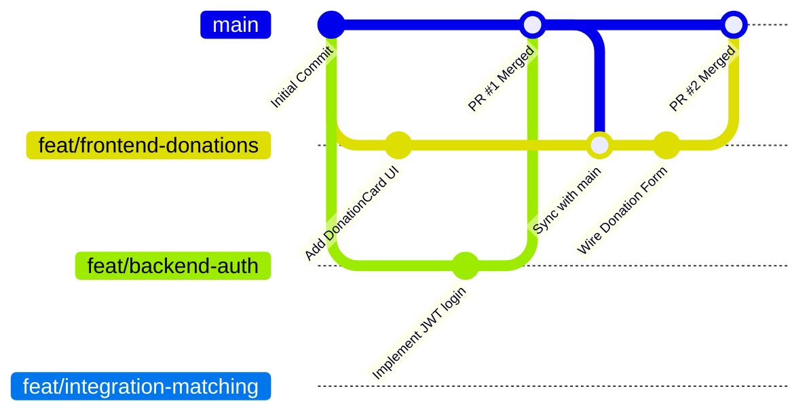

# Git Collaboration Guide — 3-Member Team Workflow

**Project:** Surplus Food Rescue  
**Audience:** All Team Members  
**Golden Rule:** Never push directly to `main`. Never force-push. Work in feature branches.

---

## 1. Branch Strategy

The team maintains a clean, single-source-of-truth Git structure:



| Branch Name Pattern | Purpose | Primary User |
| :--- | :--- | :--- |
| `main` | Production-ready, stable, integrated code. Always builds cleanly. | Protected (Shared) |
| `feat/frontend-*` | New frontend UI, pages, components, and client logic. | Member 1 |
| `feat/backend-*` | Backend NestJS endpoints, Prisma models, and auth logic. | Member 2 |
| `feat/integration-*`| Advanced algorithms, cross-module wiring, and integration tests. | Member 3 |
| `fix/*` | Urgent bugfixes discovered during integration or QA. | Any Member |

---

## 2. Beginner-Friendly Step-by-Step Daily Workflow

### Stage 1: Starting Your Work Day
Before creating a new feature branch, ensure your local `main` is completely up to date:

```bash
# 1. Switch to main
git checkout main

# 2. Pull the latest commits from your teammates
git pull origin main

# 3. Create your new focused feature branch
git switch -c feat/frontend-donor-wizard
```

---

### Stage 2: Making Commits
Make small, focused commits as you complete discrete parts of your task:

```bash
# Check what files you modified
git status

# Stage only the files you intentionally modified
git add src/features/donations/components/DonationWizard.tsx

# Commit with a clear Conventional Commit message
git commit -m "feat(donations): add multi-step donation creation wizard"
```

#### Commit Message Format
- `feat(...)`: A new user-facing feature or component.
- `fix(...)`: A bugfix.
- `chore(...)`: Configuration, dependencies, or maintenance.
- `docs(...)`: Documentation updates.
- `test(...)`: Unit, integration, or E2E tests.

---

### Stage 3: Pushing and Creating a Pull Request (PR)

1. Push your branch to GitHub:
   ```bash
   git push -u origin feat/frontend-donor-wizard
   ```
2. Open the GitHub repository URL in your browser:
   - Click the green **"Compare & pull request"** button.
   - Title your PR: `feat(donations): Implement Donation Wizard with Mock Data`.
   - In the description, summarize what was built, include a screenshot if UI changed, and confirm tests pass.
3. Request review from at least one teammate.

---

### Stage 4: Syncing Your Branch with Latest `main`
If a teammate merged changes into `main` while you were working on your branch, update your branch locally before merging:

```bash
# While on your feature branch:
git fetch origin
git merge origin/main
```

---

## 3. How to Resolve Merge Conflicts Safely

If Git reports a conflict during a merge, don't panic:

1. Run `git status` to see which files have conflicts (listed under "Unmerged paths").
2. Open the conflicting file in your editor. You will see conflict markers:
   ```text
   <<<<<<< HEAD (Your changes)
   const title = "Rescue Food Donations";
   =======
   const title = "Surplus Food Rescue Platform";
   >>>>>>> origin/main (Teammate's changes)
   ```
3. Edit the file to keep the desired code, remove the marker lines (`<<<<<<<`, `=======`, `>>>>>>>`), and save.
4. Stage the resolved file:
   ```bash
   git add path/to/resolved-file.tsx
   ```
5. Complete the merge commit:
   ```bash
   git commit -m "chore: resolve merge conflicts with main"
   ```
6. Push the resolved branch:
   ```bash
   git push origin feat/your-branch-name
   ```

---

## 4. Protected Environment Rules

- **Never Commit Secrets:** `.env`, `.env.local`, API keys, or private certificates are excluded in `.gitignore` and guarded by Antigravity security rules. Always share configuration keys via `.env.example` templates with placeholder values.
- **Never Force-Push:** Do not run `git push --force` on any shared or remote branch.
- **Keep Branches Short-Lived:** Aim to merge feature branches into `main` within 1–2 hours during a buildathon to avoid massive divergent branches.
