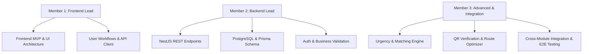

# Team Ownership & File Boundaries — Surplus Food Rescue

**Project:** Surplus Food Rescue  
**Model:** 3-Member Collaborative Engineering Team  
**Status:** Frozen Division of Responsibilities  

---

## 1. Member Roles & Core Deliverables

---

## 2. Exhaustive Role Breakdown

### Member 1 — Frontend Lead
- **Scope:** Complete user-facing frontend application.
- **Key Deliverables:**
  - Responsive layouts and reusable UI design system in Tailwind CSS v4.
  - Role-based views: Restaurant donor wizard, NGO discovery feed, Volunteer delivery tracker, Admin audit portal.
  - Client state management, caching, and mutations with TanStack Query.
  - Form validation with React Hook Form and Zod.
  - Mock API adapters for zero-delay offline development.
- **Boundaries:** Does not write backend database migrations or direct NestJS server code.

### Member 2 — Backend Lead
- **Scope:** Complete NestJS application, database models, and server infrastructure.
- **Key Deliverables:**
  - NestJS modular architecture (`auth`, `users`, `donations`, `claims`, `deliveries`, `notifications`).
  - PostgreSQL database schema and migrations using Prisma ORM.
  - Authentication (JWT), password hashing, and Role-based Guard (`RolesGuard`).
  - Input validation with `class-validator` and DTO schemas.
  - Production REST API contracts and OpenAPI / Swagger documentation.
- **Boundaries:** Does not write React UI components or frontend client styling.

### Member 3 — Advanced Modules & Integration Lead
- **Scope:** Advanced platform capabilities and seamless end-to-end integration across frontend and backend.
- **Dedicated Advanced Feature Modules:**
  - `src/features/matching/`: Algorithmic matching between food donors and nearest verified NGOs.
  - `src/features/urgency/`: Perishability countdown engine and time-decay prioritization scoring.
  - `src/features/route-optimization/`: Distance matrix and volunteer transit routing calculations.
  - `src/features/qr-verification/`: Cryptographic token generation on pickup and QR scanning confirmation on delivery handoff.
- **Key Deliverables:**
  - Impact Dashboard Metrics (carbon offset and meals-served calculation engine).
  - Cross-module end-to-end integration (Restaurant creation ➔ NGO claim ➔ Volunteer delivery ➔ Admin audit).
- **Critical Protocol & Boundaries:**
  - **No Unilateral Database Alterations:** Member 3 works against agreed API contracts and mock interfaces. Member 3 does NOT have permission to independently change the PostgreSQL schema, Prisma migrations, or alter the core donation/claim lifecycle states.
  - **Coordination with Member 2 (Backend):** When advanced algorithms require new schema fields (e.g. `qrToken`, `perishabilityScore`), Member 3 submits a formal proposal to Member 2, who owns database changes.
  - **Coordination with Member 1 (Frontend):** Member 3 builds advanced capability widgets inside the designated directories above and mounts them into Member 1's UI views via agreed component slot props (e.g. `renderUrgencyBadge?: () => ReactNode`).

---

## 3. Disjoint File Ownership Map

To prevent Git merge conflicts and accidental overwrites during rapid hackathon development, every file and directory has an explicit, disjoint owner:

| Directory / File Path | Sole Owner | Permitted Editors | Conflict Prevention Protocol |
| :--- | :---: | :---: | :--- |
| `src/app/` | Member 1 | Member 1 | Central routing and layouts; changes require Member 1 approval. |
| `src/components/ui/` | Member 1 | Member 1 | Global design system primitives. |
| `src/features/restaurant/` | Member 1 | Member 1 | Donor workflows and management. |
| `src/features/ngo/` | Member 1 | Member 1 | Food discovery and claiming interfaces. |
| `src/features/volunteer/` | Member 1 | Member 1 | Volunteer mission tracker. |
| `src/features/admin/` | Member 1 | Member 1 | Admin verification views. |
| `src/features/donations/` | Member 1 | Member 1 | Core donation wizard, listing feeds, and safety checklists. |
| `src/features/claims/` | Member 1 | Member 1 | Core claim requests, status displays, and approval modal. |
| `src/features/deliveries/` | Member 1 | Member 1 | Core delivery task lists, mission details, and handoff flows. |
| `src/features/matching/` | Member 3 | Member 3 | Donor-to-NGO algorithmic matching engine. |
| `src/features/urgency/` | Member 3 | Member 3 | Food perishability and urgency decay calculation. |
| `src/features/route-optimization/` | Member 3 | Member 3 | Volunteer routing and distance matrix calculations. |
| `src/features/qr-verification/` | Member 3 | Member 3 | QR token creation and scanning confirmation handoff widgets. |
| `server/` (NestJS root) | Member 2 | Member 2 | All NestJS controllers, services, modules, and DTOs. |
| `prisma/schema.prisma` | Member 2 | Member 2 | Database schema; Member 3 proposes additions via issue/chat. |
| `docs/architecture/` | Shared | All | Core architectural blueprints and lifecycles. |
| `docs/integration/` | Shared | All | API contracts and endpoint schemas. |
| `src/types/` | Shared | All | Shared TypeScript interfaces matching backend DTOs. |
| `package.json` (Root/Client)| Member 1 | Member 1 | New frontend packages must be approved by Member 1. |
| `package.json` (Server) | Member 2 | Member 2 | New backend packages must be approved by Member 2. |

---

## 4. Shared Coordination Rules

1. **Changing Shared Types (`src/types/`):**
   - When Member 2 changes an API endpoint response, they notify Member 1 and Member 3 before modifying the shared type file.
   - Types must remain backwards-compatible during transitions using optional fields (`fieldName?: string`).
2. **Injecting Advanced Features into Views:**
   - Member 1 provides dedicated integration slots (e.g. `
` or component props like `renderExtraBadges?: () => ReactNode`).
   - Member 3 builds the advanced component in `src/features/advanced/` and mounts it via the agreed slot prop.
3. **Database Schema Additions:**
   - If Member 3's advanced algorithm needs new database columns (e.g. `qrToken`, `perishabilityScore`), Member 3 submits a request to Member 2, who adds the column to Prisma and generates the migration.
