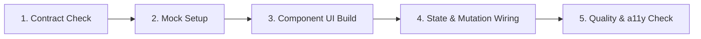

# Frontend Workflow Guide — Member 1 (Frontend Lead)

**Project:** Surplus Food Rescue  
**Audience:** Member 1 (Frontend Engineer)  
**Context:** Hackathon / Buildathon Team Collaboration  

---

## 1. Daily Development Lifecycle

To build user interfaces rapidly and prevent integration bottlenecks with Member 2 (Backend) and Member 3 (Advanced Modules), Member 1 follows this 5-stage loop:



---

## 2. Stage-by-Stage Implementation Guide

### Stage 1: Contract Check
1. Before writing UI for a new feature, check `docs/integration/API-CONTRACT-WORKFLOW.md` and `src/types/api.ts`.
2. Ensure the endpoints, request payloads, and response structures have been frozen or drafted with Member 2.
3. If an endpoint is marked `[PENDING CONTRACT CONFIRMATION]`, do not guess backend table column names. Proceed immediately with typed mock data.

### Stage 2: Mock Data Setup
1. Define the mock dataset inside `src/features/<feature>/mocks/mockData.ts`.
2. Ensure the mock objects strictly satisfy the TypeScript domain interfaces in `src/types/`.
3. Wire the mock handler in your feature hook using an artificial network delay (e.g. 300ms) to verify that loading spinners and skeleton screens behave properly:
   ```ts
   // Example: src/features/donations/hooks/useDonations.ts
   export const useDonations = () => {
     return useQuery({
       queryKey: ['donations', 'feed'],
       queryFn: async () => {
         if (import.meta.env.VITE_USE_MOCKS === 'true') {
           await new Promise((r) => setTimeout(r, 300));
           return MOCK_DONATIONS;
         }
         return api.get('/donations').then((res) => res.data);
       },
     });
   };
   ```

### Stage 3: Component & UI Build
1. Leverage the **`frontend-design`** skill guidelines:
   - Ground the design in food rescue realities: use appetizing, clean food palettes (e.g. warm sage greens, fresh terracotta, slate darks) rather than generic neon defaults.
   - Distinctive typography: Clear hierarchy with legible sans-serif for dashboard utility and warm display accents for hero/callouts.
   - Avoid generic AI tells: Avoid decorative numbered markers like `01 / 02 / 03` unless representing true sequential steps (like the 8-step rescue workflow).
2. Build UI in small atomic units:
   - Start with primitive elements in `src/components/ui/`.
   - Compose feature cards (e.g. `DonationCard.tsx`) in `src/features/donations/components/`.
   - Assemble the complete page (e.g. `DonationsFeedPage.tsx`) in `src/features/donations/pages/`.

### Stage 4: Form & Mutation Wiring
1. Declare the Zod validation schema in `src/features/<feature>/schemas.ts`.
2. Connect forms using `useForm` with `@hookform/resolvers/zod`.
3. Handle mutations with TanStack Query's `useMutation`.
4. Use centralized invalidation helpers (`src/services/queryInvalidation.ts`) on success so related list views and summaries auto-refresh seamlessly.
5. Provide resilient error handling and UX safeguards:
   - **Prevent Duplicate Submissions:** Immediately disable submit buttons and render an inline loading spinner while mutation is in flight.
   - **Offline Pre-Check:** Check `navigator.onLine` before triggering mutations; if offline, alert the user and abort submission.
   - **Preserve Form State on Failure:** Do not reset form values if an API call fails or times out. Display the inline error banner and let the user retry with a single click.
   - **Avoid False Success:** Never display a success message or optimistically update mission/claim states without a resolved API or mock confirmation.
   - **Clear User Alerts:** Display informative notification toasts on success or failure with actionable retry suggestions.

### Stage 5: Quality, Mobile, Error & a11y Verification
Before submitting a pull request, run through the **Frontend Definition of Done**:
- [ ] **TypeScript Check:** `npm run typecheck` passes with zero errors.
- [ ] **Lint Check:** `npm run lint` passes with zero errors.
- [ ] **Mobile Responsiveness:** Tested in browser responsive mode at 375px (iPhone standard), 768px (iPad portrait), and 1280px (Desktop).
- [ ] **Three-Tier States:** Verified that Loading skeleton, Empty state, and Error states all render properly.
- [ ] **Error Boundary & Offline Handling:** Verified that unhandled render crashes show the friendly recovery screen and that offline triggers disable mutations safely without losing entered form data.
- [ ] **Web Design Guidelines Audit:** Checked touch targets (minimum 44x44px), form label associations, and keyboard `Tab` navigation.

---

## 3. Applying Project-Local Skills in Daily Work

The Surplus Food Rescue repository contains 4 local skills in `.agents/skills/`. When invoking Antigravity for assistance, leverage them as follows:

| Skill | When to Apply in Frontend Work |
| :--- | :--- |
| **`frontend-design`** | Building new screens, landing pages, donor wizards, or establishing brand aesthetic and visual hierarchy. |
| **`web-design-guidelines`** | Reviewing completed components or forms for accessibility, WCAG compliance, and polish before pushing to Git. |
| **`vercel-composition-patterns`** | Refactoring complex components when boolean props begin proliferating (`isUrgent`, `isClaimed`, `isRestaurantView`). Use compound components instead. |
| **`vercel-react-best-practices`** | Checking data-fetching patterns, eliminating redundant renders, and optimizing list rendering performance in the discovery feed. |

---

## 4. Working Smoothly with Teammates

1. **Working with Member 2 (Backend):**
   - Never wait for backend endpoints to be deployed before building UI. Build with mock data first.
   - Once backend routes are live, toggle `VITE_USE_MOCKS=false` in `.env.local` to switch to live NestJS APIs.
2. **Working with Member 3 (Advanced Modules & Integration):**
   - Provide well-defined slot components or prop callbacks for advanced modules (e.g. reserving a container in `DonationCard` where Member 3 can inject an `UrgencyBadge` or `RouteOptimizer` widget).
   - Coordinate in `docs/team/TEAM-OWNERSHIP.md` before altering shared page layouts.
